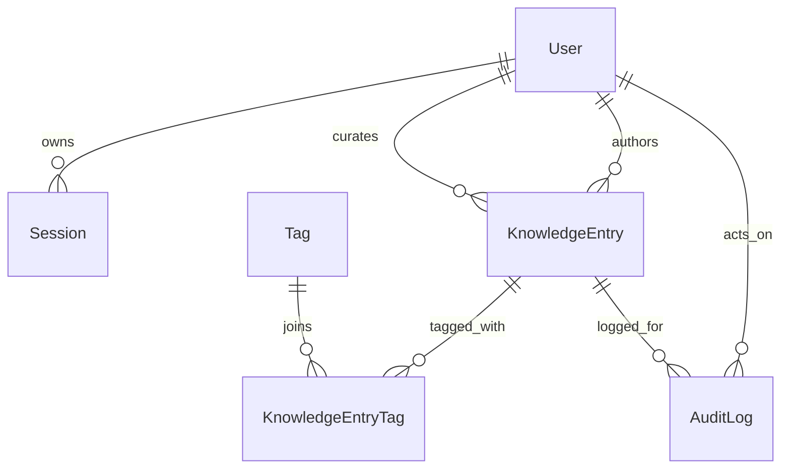

# Domain Model

## User

- Schema/model file: [`prisma/schema.prisma`](../../prisma/schema.prisma) — `model User`
- Primary service file: [`src/services/authService.ts`](../../src/services/authService.ts) — `loginWithEmail()`
- Notes: Stores the role (`VIEWER`, `EDITOR`, `ADMIN`) that powers the permission matrix in [`src/lib/auth/permissions.ts`](../../src/lib/auth/permissions.ts).

## Session

- Schema/model file: [`prisma/schema.prisma`](../../prisma/schema.prisma) — `model Session`
- Primary service file: [`src/lib/auth/session.ts`](../../src/lib/auth/session.ts) — `getSessionFromToken()` and `requireServerSession()`
- Notes: Session rows back the HTTP-only cookie named in [`src/lib/env.ts`](../../src/lib/env.ts).

## KnowledgeEntry

- Schema/model file: [`prisma/schema.prisma`](../../prisma/schema.prisma) — `model KnowledgeEntry`
- Primary service file: [`src/services/knowledgeEntryService.ts`](../../src/services/knowledgeEntryService.ts) — `createDraftEntry()`, `changeEntryStatus()`, `curateEntry()`
- Notes: This is the central content object. Searchable fields (`title`, `summary`, `content`) and curation fields (`isFeatured`, `manualBoost`) are combined in the ranking query inside [`src/repositories/knowledgeEntryRepository.ts`](../../src/repositories/knowledgeEntryRepository.ts).

## Tag

- Schema/model file: [`prisma/schema.prisma`](../../prisma/schema.prisma) — `model Tag`
- Primary service file: [`src/services/tagService.ts`](../../src/services/tagService.ts) — `listAvailableTags()`
- Notes: Editors do not manage tags through a separate admin screen; tags are normalized and upserted during entry save in `upsertTagsByNames()` from [`src/repositories/tagRepository.ts`](../../src/repositories/tagRepository.ts).

## KnowledgeEntryTag

- Schema/model file: [`prisma/schema.prisma`](../../prisma/schema.prisma) — `model KnowledgeEntryTag`
- Primary service file: [`src/services/knowledgeEntryService.ts`](../../src/services/knowledgeEntryService.ts) via `createDraftEntry()` and `updateDraftEntry()`
- Notes: Explicit join table keeps tag assignment reviewable and easy to replace inside a transaction.

## AuditLog

- Schema/model file: [`prisma/schema.prisma`](../../prisma/schema.prisma) — `model AuditLog`
- Primary service file: [`src/services/knowledgeEntryService.ts`](../../src/services/knowledgeEntryService.ts) through `createAuditLog()` calls inside each transaction
- Notes: Mutation events for create, update, status change, and curation are written through [`src/repositories/auditLogRepository.ts`](../../src/repositories/auditLogRepository.ts).
