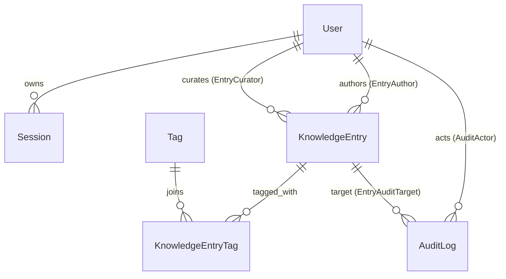

# Domain Model

The source of truth is `prisma/schema.prisma`: 6 models and 2 enums. The migration `prisma/migrations/20260416000000_initial_schema/migration.sql` adds one index that the schema cannot express: the GIN full-text index at `:112-120`.

## Enums

- `UserRole`: `VIEWER`, `EDITOR`, `ADMIN` (`schema.prisma:18-22`), ordered by `roleOrder` in `src/lib/auth/permissions.ts:20-24`.
- `EntryStatus`: `DRAFT`, `PUBLISHED`, `ARCHIVED` (`schema.prisma:24-28`), with transitions in `permissions.ts:78-91`.

## Models

### User (`schema.prisma:30-44`)
- `email @unique`, `role`, `passwordHash`. Indexed on `role`.
- Written only by the seed (`prisma/seed.ts:7-38`). There is no signup or user-admin API.
- Read by `findUserByEmail` (login) and through `Session.user` (every request).

### Session (`:46-56`)
- `token @unique` holds the raw token, `expiresAt` is indexed, and it belongs to a `userId`.
- Written by `createSession`. Deleted by `invalidateSessionByToken` on logout and on expired access (`src/lib/auth/session.ts:48-52`).

### KnowledgeEntry (`:58-82`)
- Content: `slug @unique`, `title`, `summary`, `content`.
- Workflow: `status` (default `DRAFT`) and `publishedAt`.
- Curation: `isFeatured`, `manualBoost` (Int, default 0), `curationNotes`, `curatedById` (`onDelete: SetNull`).
- Ownership: `authorId` (`onDelete: Restrict`, so a user with entries cannot be deleted).
- Indexes: `(authorId, status)` for workspace lists, `(status, publishedAt)`, and `(isFeatured, manualBoost)`.
- Written by four repository functions (`src/repositories/knowledgeEntryRepository.ts:266-402`), always inside a service transaction.

### Tag (`:84-92`)
- `slug @unique` **and** `name @unique` (`@@unique([name])`).
- There is no tag-management UI. Tags are created or renamed implicitly by `upsertTagsByNames` whenever an entry is saved (`src/repositories/tagRepository.ts:14-37`).

### KnowledgeEntryTag (`:94-102`)
- An explicit join with composite primary key `(entryId, tagId)`.
- Replaced wholesale on update (`deleteMany: {}` then `create`, `knowledgeEntryRepository.ts:322-325`).

### AuditLog (`:104-119`)
- `action` (free string), `targetType`, `targetId`, `actorId?`, `entryId?`, `metadata Json?`.
- Indexed for lookup by target, by entry, and by actor over time.
- Written in four places in `src/services/knowledgeEntryService.ts`: create `:105`, update `:148`, status `:181`, curate `:221`. **Nothing reads it.** There is no endpoint or page for audit history.

## Derived and duplicated state

- **`publishedAt`** is set to `now` when status becomes `PUBLISHED` and to **null for every other status** (`knowledgeEntryRepository.ts:352`). Archiving erases the original publish date. A same-status "transition" (`PUBLISHED` to `PUBLISHED` is allowed by `permissions.ts:79-81`) resets it to now, which moves the entry up the `publishedAt DESC` tie-break in search.
- **Curation fields survive archiving.** An archived, featured entry keeps `isFeatured` and `manualBoost`. If it is restored and republished, it re-enters search still boosted. `curateEntry` only blocks curating *non-published* entries (`knowledgeEntryService.ts:209-211`). The seed itself gives a draft `manualBoost: 1` (`prisma/seed.ts:141`).
- **The tag-name search weight uses names, not slugs.** `string_agg(DISTINCT tag."name", ' ')` is weighted `B` in the ranking document (`knowledgeEntryRepository.ts:204`, `:226`).

## Invariants: where each lives

| Invariant | DB | Code |
| --- | --- | --- |
| Unique slug | `KnowledgeEntry_slug_key` | Pre-check `findEntryBySlug` (`knowledgeEntryService.ts:88-92`, `:132-136`), which is check-then-act |
| Unique tag slug and name | two unique indexes | `upsert` by slug, which **overwrites** the name |
| Valid transition | none | `isValidStatusTransition` + `canTransitionEntry` |
| `manualBoost` from 0 to 25 | none | Zod (`src/lib/validation/knowledgeEntrySchemas.ts:63`) |
| Curate only published | none | `knowledgeEntryService.ts:209-211` |
| At least 1 and at most 6 tags | none | Zod (`knowledgeEntrySchemas.ts:43`) |

## Senior review findings

1. **The GIN index does not match the search query.** The index covers `title || summary || content` (`migration.sql:112-120`). The query builds a different expression that also concatenates `string_agg(tag."name")`, and it evaluates it in `HAVING` after `GROUP BY` (`knowledgeEntryRepository.ts:220-229`). Postgres can only use an expression index when the query uses the same expression in a usable position, so this query computes `to_tsvector` for every published entry on every search. Fine at seed scale; a real cost at thousands of entries.
2. **The slug race becomes a 500.** Two concurrent creates with the same slug both pass `findEntryBySlug`. The second insert violates `KnowledgeEntry_slug_key`, and `apiError` maps unknown errors to 500 (`src/lib/http/responses.ts:36-46`).
3. **Duplicate tag slugs within one request can collide.** `dedupe` runs on trimmed names, not slugs (`tagRepository.ts:15`). `["On Call", "on-call"]` produces two upserts on the slug `on-call`, run concurrently through `Promise.all` (`:20-28`).

## Exercises

1. **Goal:** Predict `publishedAt` through publish, archive, restore, and publish again.
   **Check:** Each `updateKnowledgeEntryStatus` call sets it to `new Date()` or `null` (`knowledgeEntryRepository.ts:352`). It ends as the latest publish time, and the first publish time is not stored anywhere, except in the audit metadata's `previousStatus`/`nextStatus` (which records statuses, not times).
2. **Goal:** Find which seed entry would rank first for an empty query.
   **Check:** With no query, `textRank` is 0 (`:208`). The score is then `1.5` (if featured) plus `0.15 x boost`. "VPN Access Runbook" is featured with boost 5 (`prisma/seed.ts:75-79`), giving 2.25, which is higher than the other published entry's boost 2 (`:111`), which gives 0.3.
